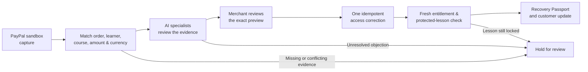

<div align="center">
  
  <h1>PayTrace Recover</h1>
  <p><strong>Payment made. Access restored—and verified.</strong></p>
  <p>AI-assisted recovery for customers who paid for digital access but never received it.</p>
  <p>
    <a href="https://paytrace-recover-sagitta.azurewebsites.net/judge.html"><strong>Judge walkthrough</strong></a> ·
    <a href="https://paytrace-recover-sagitta.azurewebsites.net/focus.html">Merchant workspace</a> ·
    <a href="https://paytrace-recover-sagitta.azurewebsites.net/showcase.html">Product screenshots</a> ·
    <a href="docs/JUDGE-TESTING.md">Testing guide</a>
  </p>
  <p>
    <a href="https://github.com/sagitta414/paytrace-recover/actions/workflows/verify.yml"></a>
    
    <a href="LICENSE"></a>
    
  </p>
</div>

> **Prototype status:** The public walkthrough uses fictional records and scripted specialists. The Azure app has server-backed PayPal sandbox, model, course-service, and Render integrations. A separate screen recording shows a saved connected sandbox proof report and customer outcome, but the independent connected acceptance check has not been rerun for this release. [See the dated integration status.](docs/INTEGRATION-STATUS.md)

## The problem

A customer pays for a course, but the lesson stays locked. The payment platform says “completed”; the course system says “no access.” A merchant needs to know whether those records belong to the same purchase, what went wrong, what change is safe, and whether the customer can actually open the lesson.

PayTrace Recover connects those steps in one case. It proposes the smallest purchase-specific correction, keeps the merchant in control, and treats a successful access write as **unfinished until the lesson is checked**.

The private customer case now links to a learner-facing [course view](dist/course.html). It shows the first lesson locked while access is unverified, then opens the same lesson through the protected customer API after verification. The browser never receives the course-service key. A current sandbox case and a fictional sample are labeled separately.

## How recovery works



Four model-backed specialist perspectives support the investigation when AI is configured: **Ledger** checks payment, **Relay** follows the handoff, **Patch** proposes a narrow repair, and **Prism** challenges unsupported conclusions. Their findings cite saved source IDs. Deterministic checks—not an agent’s assertion—gate a correction.

## What you can explore

| Surface | What it does |
| --- | --- |
| **Merchant desk** | Prioritizes cases, shows the decision and next action first, then exposes source evidence, specialist findings, customer messages, and the case timeline. |
| **Recovery Passport** | Records payment, investigation, authorization, correction, lesson proof, buyer-browser receipt, and customer confirmation as separate stages. |
| **Customer view** | Gives the buyer a private progress path, a way to reply or ask for help, and a separate chance to confirm whether access works. |
| **Connection Studio** | Maps a store event and checks a sandbox capture against a purchase intent registered before checkout. Shared-account reporting discovery is paused until merchant-scoped credentials are available. |
| **Recovery Center** | Provides notifications, audit history, incident views, prevention signals, read-only simulations, and bounded opt-in sandbox automation. |

The working example is **one paid course with missing access**. Membership and download connectors are future work. [Explore the feature-to-test matrix.](docs/FEATURE-ACCEPTANCE.md)

## Try the app

### Hosted demo

Start with the [judge walkthrough](https://paytrace-recover-sagitta.azurewebsites.net/judge.html). It separates the scripted story from the server-backed [merchant workspace](https://paytrace-recover-sagitta.azurewebsites.net/focus.html). The [public browser simulation](https://courselatch.sagitta107.chatgpt.site/focus.html) is a separate static experience; its fictional state does not carry into the Azure app.

The Azure demo may take time to wake on its shared plan. Check [`/health](https://paytrace-recover-sagitta.azurewebsites.net/health) before relying on a live walkthrough.

### Run locally

Requires **Node.js 24+**. No provider credentials are needed for the server-backed sample.

```bash
git clone https://github.com/sagitta414/paytrace-recover.git
cd paytrace-recover
npm ci
npm test
npm start
```

Open **http://127.0.0.1:4358/judge.html**, then the merchant desk. The sample cases exercise backend rules with fictional provider records. To serve the standalone static simulation instead, run `node serve.cjs` and open `http://127.0.0.1:4357`.

For a connected sandbox setup, use [`.env.example`](.env.example) and the [PayPal/AI/Render build guide](docs/BUILD-README.md). Keep secrets server-side and out of Git. The [judge testing guide](docs/JUDGE-TESTING.md) gives a reproducible sample path and a separate connected test sequence.

## Architecture and safety

```text
Browser UI (dist/) ──> Node API (server/) ──> durable SQLite state
                              ├── PayPal sandbox payment reads
                              ├── AI Responses specialist review
                              ├── tenant-scoped reference course service
                              └── optional Render Workflow tasks
```

- A fresh completed capture must match the saved order, learner, course, amount, and currency. A webhook is a trigger to recheck, not permission to grant access.
- The merchant approves the exact current preview. An off-by-default sandbox policy can authorize only bounded reference-course cases that pass the same fresh checks and model review.
- Corrections use a purchase-scoped idempotency key. Verification retries reread payment, entitlement, and protected content without another grant.
- Customer confirmation, buyer-browser receipt, and technical lesson proof remain separate facts. Private customer records stay behind scoped access.

[Architecture and setup](docs/SETUP.md) · [Course connector contract](docs/COURSE-ACCESS.md) · [Recovery and security decisions](docs/INTEGRATION-DECISIONS.md)

## Evidence, not just configuration

| Evidence level | What it establishes |
| --- | --- |
| **Automated tests and CI** | Local business rules, API boundaries, failure handling, and mocked provider contracts. |
| **Scripted walkthrough** | The intended merchant and buyer experience using fictional records. |
| **Configured-provider checks** | Connectivity to a particular sandbox service; not a completed recovery. |
| **Connected case acceptance** | One refreshed case with exact sandbox payment, actual model review, approval, one grant, and current external lesson proof. The stricter mode also requires Render. |

Run `npm run test:coverage` for the repository coverage gate and `npm run check:review-links` for judge/submission links. The read-only `npm run acceptance:check -- --mode=hackathon` assesses saved evidence for a privately configured case; the default `connected` mode additionally requires Render. Neither command performs checkout or certifies hackathon eligibility. [Current integration status](docs/INTEGRATION-STATUS.md) and the [release guide](docs/RELEASE-CANDIDATE.md) list what remains unproven.

## Project guides

| For | Start here |
| --- | --- |
| Judges and reviewers | [Judge testing](docs/JUDGE-TESTING.md) · [Demo script](docs/DEMO_SCRIPT.md) |
| Builders | [Setup](docs/SETUP.md) · [Connected build guide](docs/BUILD-README.md) · [Course contract](docs/COURSE-ACCESS.md) |
| Release and operations | [Integration status](docs/INTEGRATION-STATUS.md) · [Release candidate](docs/RELEASE-CANDIDATE.md) · [Backups](docs/BACKUPS.md) |
| Submission | [Devpost draft](docs/DEVPOST-SUBMISSION.md) · [Video plan](docs/VIDEO-RECORDING.md) |

## License and scope

Released under the [MIT License](LICENSE). PayTrace Recover is an independent hackathon prototype, not an official PayPal product. It uses **PayPal sandbox only**, has no production payment processing, and does not yet include a commercial course-platform connector or a completed buyer-to-lesson connected acceptance record. PayPal names and marks belong to their respective owners.
