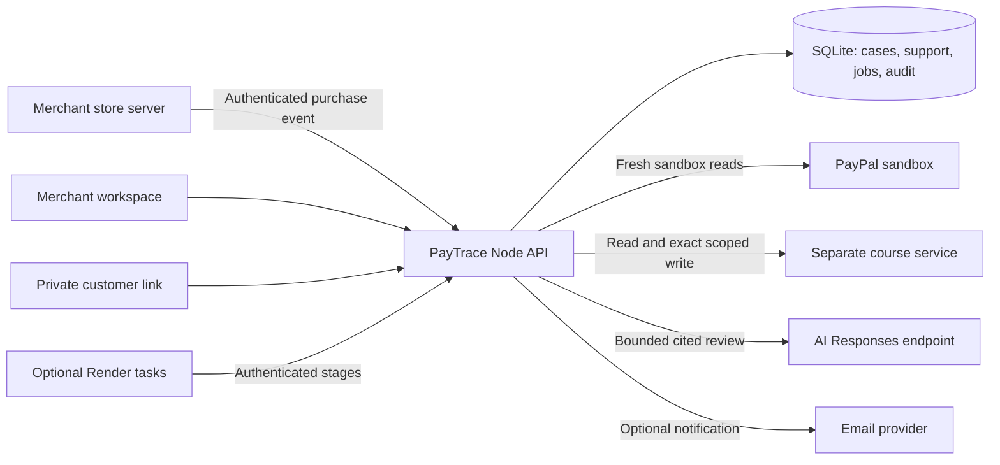

# PayTrace Recover

**Trace a completed payment to missing digital access. Review a precise correction. Verify the outcome.**

PayTrace Recover is a sandbox prototype for merchants handling “I paid, but I can’t get in.” Its first supported use case is a purchased course. It compares payment and access evidence, runs a four-specialist investigation, rehearses a narrow entitlement change, records merchant approval, applies an idempotent correction, and checks protected lesson access.

A write is not proof of recovery. Current technical verification, a buyer-browser receipt, and customer confirmation are separate facts.

[Project overview](dist/project.html) · [Interactive sample](dist/demo.html) · [Judge walkthrough](dist/judge.html) · [Feature acceptance matrix](docs/FEATURE-ACCEPTANCE.md) · [Review results](docs/VALIDATION-2026-11-04.md)

## Hackathon submission kit

Start with [current submission status](docs/SUBMISSION-STATUS.md), [Devpost description and tools disclosure](docs/DEVPOST-SUBMISSION.md), [judge testing instructions](docs/JUDGE-TESTING.md) and [2:40 recording plan](docs/VIDEO-RECORDING.md). These are prepared materials, not proof of a completed video or submitted entry. November 5 dependency audit reported zero vulnerabilities; hosted preflight timed out from the review session.

For a configured case, `npm run acceptance:check -- --mode=hackathon` checks core PayPal/model/approval/external lesson evidence without optional Render execution. The default `connected` mode still requires all six sources. Both are read-only saved-evidence checks, not official eligibility determinations. Private provider access is needed to complete a genuine connected run.

## Status and evidence

This review starts from GitHub `main` commit `eff16c73a128db0ff23a9277d431e9ae35c8e815`, fetched November 4, 2026. The unchanged baseline passed **276 automated tests** with no failures or skips. See the validation report for checks after the documentation/page changes.

| Mode | What it does | What it does not establish |
| --- | --- | --- |
| Static browser demonstration | Fictional records and scripted specialist interactions | Real provider reads, persistent server work, or connected recovery |
| Local server demo | SQLite-backed cases, support links, recovery rules and local protected lesson | External course delivery or a real PayPal capture |
| Configured sandbox | Optional PayPal, AI, separate course service, email and Render calls | Configuration alone is not successful acceptance |
| Verified merchant mode | Implemented OIDC/MFA membership and role boundaries | Live identity-provider acceptance still needs private setup |

Earlier deployment notes record Azure AI evaluation and authenticated course-service reads. This review does not independently repeat those private tests. A complete connected PayPal-to-lesson recovery, Render execution, real identity/MFA and email delivery still require recorded acceptance evidence. PayPal is **sandbox only**. A commercial LMS adapter and multi-host production deployment are outside the demonstrated scope.

## Quick start

Requirements: **Node.js 24 or newer**, npm, Git, and an available local port. There is no compilation step; current browser assets are authored in `dist/`.

In PowerShell:

```powershell
cd "C:\path\to\paytrace-recover"
npm ci
npm test
npm start
```

Use your actual checkout path. PowerShell uses `cd "path"`; the `/d` switch belongs to Command Prompt.

Open [the local project page](http://127.0.0.1:4358/project.html), [judge walkthrough](http://127.0.0.1:4358/judge.html), or [merchant workspace](http://127.0.0.1:4358/focus.html). No provider credentials are needed for server-demo mode. Stop with **Ctrl+C**.

For an optional private configuration file:

```powershell
Copy-Item .env.example .env
```

Edit `.env` locally; never commit it. To use another port, update both values together:

```powershell
$env:PORT = "4362"
$env:PUBLIC_URL = "http://127.0.0.1:4362"
npm start
```

The normal server binds all interfaces; use local firewall/network controls when running demo mode. Private customer and team links are bearer access links: do not publish them or include them in screenshots.

### Ports and pages

| Port | Purpose | How selected |
| --- | --- | --- |
| 4358 | Default Node backend and browser assets | `npm start`; override `PORT` and `PUBLIC_URL` together |
| 4357 | Static browser simulation | `node serve.cjs`; no Node API or durable workspace |
| 4362 | Isolated local review preview | Review-only override, not a second required service |
| Configured separately | Reference course-access service | See its example and course-service guide |

There is no separate frontend dev-server port for normal operation.

| Page | Purpose |
| --- | --- |
| `/project.html` | Project overview, architecture story and evidence boundaries |
| `/judge.html` | Short evaluation route and readiness explanation |
| `/demo.html`, `/story.html` | Fictional interactive recovery stories |
| `/focus.html` | Merchant Today view, queue, case review and connections |
| `/recovery.html` | Analytics, notifications, audit, priorities, automation, team and operations |
| `/store-demo.html` | PayTrace-hosted sandbox storefront |
| `/connection-studio.html` | Trusted store-event field mapping and activation |
| `/passport.html` | Merchant evidence trail for the selected authorized case |
| `/customer.html` | Customer entry; case details require a private case link |
| `/account.html` | Verified merchant sign-in and membership setup |
| `/health` | Database-aware health response; not connected acceptance |

## Feature inventory

### Merchant workspace

- Today dashboard for decisions, waiting customers and outcomes needing verification.
- Case search, filters, persistent priorities, related-case views, new sample/sandbox cases and activity history.
- Decision brief, guided mode, tour and connection status.
- Timeline joining recovery events, customer messages and separate private notes.
- Customer-visible next-update promises, private reminders, workspace CSV and case outcome facts.

### Payment and access investigation

- PayPal sandbox order creation, checkout capture and fresh authoritative payment reads.
- Exact order, learner, course, amount, currency and account checks; separate course-entitlement comparison.
- Delivery targets, overdue monitoring, source timestamps and purchase-evidence comparison.
- Break Point Map, related-case detection and possible shared-incident alerts.
- Cause-specific holds for pending, mismatched, expired, wrong-account, stale or uncertain evidence.

### AI specialists

| Specialist | Responsibility |
| --- | --- |
| Ledger | Payment evidence |
| Relay | Events and handoffs |
| Patch | Smallest safe correction proposal |
| Prism | Independent objections and challenge |

The case view includes cited findings, challenge discussion, recommendations and read-only specialist follow-ups. Optional AI can rank cases, add incident perspectives or suggest store mappings. Mapping suggestions use field names/types rather than buyer values. Model-backed review needs configured AI; public guided stories use scripts. AI never supplies merchant approval or directly authorizes a grant.

### Correction and verification

- Exact-change rehearsal and evidence-bound merchant approval.
- Fresh payment and entitlement checks before correction; idempotent grant protection and durable recovery jobs.
- Protected-lesson check after correction; read-only verification retries without repeating grants.
- Recognition of course-system self-restoration without a PayTrace grant.
- Holds for unresolved objections, stale evidence, ambiguous writes and possible shared incidents.
- Opt-in sandbox autopilot with amount/daily limits, **off by default**. Its bounded authorization is separate from the normal per-case approval path.

### Customer experience

- Purchase-support entry, private progress tracker and simpler Recovery Passport.
- Two-way messages, information requests and visible update promises with overdue status.
- Read-only access self-check and currently verified demo lesson access.
- One-use buyer-browser receipt, separate “It works” confirmation and “I still need help” response.
- Optional email links/notifications. Provider acceptance and attempted delivery are not inbox confirmation.

### Evidence, reporting and integration

- Seven Passport stages: payment, investigation, approval, correction, lesson proof, buyer-browser receipt and customer confirmation.
- Flight recorder, case history, expiring verification receipt, evidence packet, audit search, currency-separated analytics and run reports.
- Reports label checks **connected**, **demo** or **incomplete**.
- Authenticated/idempotent server-to-server purchase intake, fresh PayPal matching, store JSON mapping preview and checked activation; edits deactivate mappings.
- Store-key creation/rotation, verified sandbox webhooks and read-only PayPal reporting discovery. Events/reporting candidates cannot authorize a repair.

### Team and operations

- Demo operator controls; Admin, Manager, Analyst and Read-Only role boundaries and redaction.
- Implemented OIDC/MFA memberships, awaiting configured identity acceptance.
- SQLite durability, scoped writes, leases/jobs, retry tracking and operational diagnostics.
- Encrypted backup and restore-check tooling; configurable audit integrity key.
- Optional Azure tracing/alerts, GitHub Actions, model evaluations, hosted preflight and connected acceptance checks.

See [the acceptance matrix](docs/FEATURE-ACCEPTANCE.md) for implementation locations, test families and remaining external proof.

## Architecture and safety boundaries



The deterministic recovery rules remain authoritative. Evidence changes invalidate review/approval; a webhook triggers fresh reads rather than trusting the payload as proof. Identity mismatches and incomplete reads hold the case. Protected-content failure leaves recovery unverified. Rechecking access does not grant again. Refund/reversal handling targets the exact purchase and blocks further recovery while held.

Customer projections omit merchant-private notes and source details. Role checks run on the server. Session isolation and same-origin mutation checks protect the merchant boundary. Demo operator keys and bearer team links are demonstration controls, separate from verified OIDC/MFA membership. The reference course service is a demo contract, not a verified integration with a commercial LMS.

SQLite and local job coordination are intended for one durable host. Do not enable multi-host scaling against independent local databases. Protect stable identity, audit, course and backup keys outside Git. Proof freshness is bounded; a past passing check is not a permanent access guarantee.

## Configuration

`.env.example` is the authoritative example. Provide secrets through local `.env` or private hosting settings. Never send them in a URL, browser field intended for public content, commit, issue or screenshot.

| Area | Variables | Setup guide |
| --- | --- | --- |
| Local server | `PORT`, `PUBLIC_URL`, `DATABASE_PATH`, optional `VERIFICATION_MAX_AGE_SECONDS` | [Setup](docs/SETUP.md) |
| Sandbox PayPal | `PAYPAL_CLIENT_ID`, `PAYPAL_CLIENT_SECRET`, optional `PAYPAL_WEBHOOK_ID` | [Connected demo](docs/CONNECTED-DEMO.md), [webhooks](docs/PAYPAL-WEBHOOKS.md) |
| Separate course service | `COURSE_ACCESS_URL`, `COURSE_ACCESS_API_KEY` | [Course contract](docs/COURSE-ACCESS.md), `examples/course-service.mjs` |
| AI | `OPENAI_API_KEY`, `OPENAI_MODEL`, optional `OPENAI_BASE_URL` for Azure v1 endpoint | [Build guide](docs/BUILD-README.md) |
| Render | `WORKFLOW_SECRET`, `APP_URL`, `RENDER_API_KEY`, exact investigation/recovery task slugs | [Connected demo](docs/CONNECTED-DEMO.md) |
| Demo operator | `DEMO_OPERATOR_KEY` | [Setup](docs/SETUP.md) |
| Verified merchants | `AUTH_REQUIRED`, OIDC issuer/client settings, MFA settings, bootstrap admin emails | [Verified release setup](docs/RELEASE-CANDIDATE.md) |
| Email | `RESEND_API_KEY`, `EMAIL_FROM` | [Customer support](docs/CUSTOMER-SUPPORT.md) |
| Audit/backup | `AUDIT_HMAC_KEY`, `BACKUP_ENCRYPTION_KEY`, `BACKUP_DIR`, `BACKUP_KEEP` | [Backups](docs/BACKUPS.md), [Recovery Center](docs/RECOVERY-CENTER.md) |
| Telemetry | `APPLICATIONINSIGHTS_CONNECTION_STRING` | [Observability](docs/OBSERVABILITY.md) |

Configure verified mode only after the identity provider and course connector are ready. Production/verified startup deliberately fails closed when required configuration is missing. Keep demo and real merchant environments separate. PayPal live credentials are unsupported.

## Testing and acceptance

```powershell
npm test
npm run hosted:preflight -- http://127.0.0.1:4358
```

The default suite uses Node's test runner with sequential test-file execution. It includes business rules, HTTP behavior, provider mocks, authorization, privacy, retry/idempotency, mapping/intake, customer progress, proof freshness, backups and acceptance assessment. Tests do not charge buyers or demonstrate live external delivery.

Optional configured checks:

```powershell
npm run ai:smoke
npm run ai:eval
npm run course:smoke
npm run hosted:preflight -- https://YOUR-HOST/ --require-connected
npm run acceptance:check
```

AI checks call the configured model and can incur provider usage. `acceptance:check` requires a private selected-case session and the environment variables documented in [RELEASE-CANDIDATE.md](docs/RELEASE-CANDIDATE.md). It is read-only and validates saved six-signal evidence; it does not perform checkout, approval or grant. Never paste a session cookie into an issue or commit.

### Manual evaluation route

1. Open `/project.html`, then `/demo.html`; confirm the sample label remains visible.
2. Open the merchant workspace. Review a matching paid sample, examine the specialist evidence, rehearse and approve the exact correction.
3. Apply once and inspect lesson proof. Retry verification and confirm the write count remains one.
4. Try wrong-order, wrong-account, missing-payment and already-restored scenarios. Unsafe evidence must not grant access; self-restoration needs verification without a grant.
5. Open the private customer link. Check messages, update promise, access self-check, lesson/browser receipt and separate confirmation/help responses. Merchant notes must stay private.
6. Inspect analytics, audit, receipt expiry, roles, store mappings and connection checks. Disabled/unconfigured actions must explain their prerequisites.
7. For external acceptance, follow one sandbox case from genuine sandbox checkout through all six connected checks and retain its run report. Verify refunds, duplicate delivery and interrupted retries using the release guide.

## Deployment, data and backups

Use [Azure deployment](docs/AZURE-DEPLOYMENT.md) for the existing hosting approach. `render.yaml` describes an optional web service; `render-workflow.yaml` describes the separate Workflow service. Inspect configuration and cost before provisioning. A static Sites deployment cannot run this Node/SQLite backend.

Persist `DATABASE_PATH` on durable private storage. Restarting or redeploying an ephemeral filesystem can lose cases. Encrypt backups with a stable private base64-encoded 32-byte key, retain the key separately, and test restoration:

```powershell
npm run backup
npm run restore -- "C:\private\snapshot.pbackup" "C:\private\restored.sqlite"
```

Restore into a new destination; never overwrite a live database. The backup command performs integrity and row-count restore checks. A successful local backup is not proof that an off-host disaster-recovery copy exists. Preserve external audit checkpoints and test the complete operational procedure before relying on it.

## Repository map

| Path | Contents |
| --- | --- |
| `dist/` | Current browser pages/assets and shared deterministic recovery models |
| `server/` | HTTP API, persistence, authorization, provider adapters and durable operations |
| `tests/` | Automated rules, HTTP and mocked contract tests |
| `scripts/` | AI checks, course smoke, hosted preflight and connected acceptance |
| `examples/` | Reference course-access service |
| `workflows/` | Render investigation/recovery task definitions |
| `docs/` | Product, integration, operations and acceptance guides |
| `source/`, `design/` | Historical design material and drafts |
| `.github/` | CI automation |
| `.openai/hosting.json` | Existing static Sites project identity |

Do not run the legacy `export-demos.cjs` generator over current pages; it restores older design output.

## Troubleshooting

| Symptom | Check |
| --- | --- |
| PowerShell rejects `cd /d` | Use `cd "full path"` without `/d` |
| Port already in use | Stop the old process or change both `PORT` and `PUBLIC_URL` |
| SQLite import fails | Check `node --version`; Node 24+ is required |
| Buttons show locked/not configured | Inspect Connections; configured integrations require the operator or verified membership gate |
| Same-origin request rejected | Ensure browser origin and `PUBLIC_URL` agree, including scheme and port |
| Lesson proof expired | Refresh evidence with read-only verification; do not repeat a grant |
| PayPal payment mismatch | Check sandbox app, exact capture/order, buyer/course, amount and currency; do not bypass the hold |
| Verification fails after a write | Keep the case open, inspect provider evidence and retry reads |
| Email accepted but not received | Check delivery attempts/provider status; acceptance is not inbox delivery |
| Verified mode will not start | Complete OIDC/MFA and course connector settings before enabling it |
| Backup fails | Check private directory permissions and the base64 32-byte encryption key |
| Hosted preflight passes | Continue case-level acceptance; reachability/configuration is not recovery proof |

## Known limits and next acceptance gates

- Sandbox-only payments; no live payment processing or raw card storage.
- No independently demonstrated complete connected recovery in this review.
- Configured OIDC/MFA, email, Render, provider refunds and receiving course-platform behavior need external acceptance.
- The example course service is a prototype, not a commercial LMS connector.
- AI can be mistaken; citations identify records rather than proving reasoning. Human review and deterministic checks remain necessary.
- Multi-host scaling, merchant pilot outcomes, accessibility certification and production readiness are not established by unit tests.
- Technical verification does not imply customer satisfaction; retain both outcomes.

## Contributing and license

Read [AGENTS.md](AGENTS.md), keep credentials/runtime databases out of commits, run `npm test`, and describe connected versus mocked evidence in pull requests. Preserve exact-purchase safeguards and read-only verification retries. Leave proposed changes open for review before merging.

Source is [MIT licensed](LICENSE). Third-party dependencies retain their licenses. PayTrace Recover is a working name, not a trademark-clearance claim; this independent project is not endorsed by PayPal.
